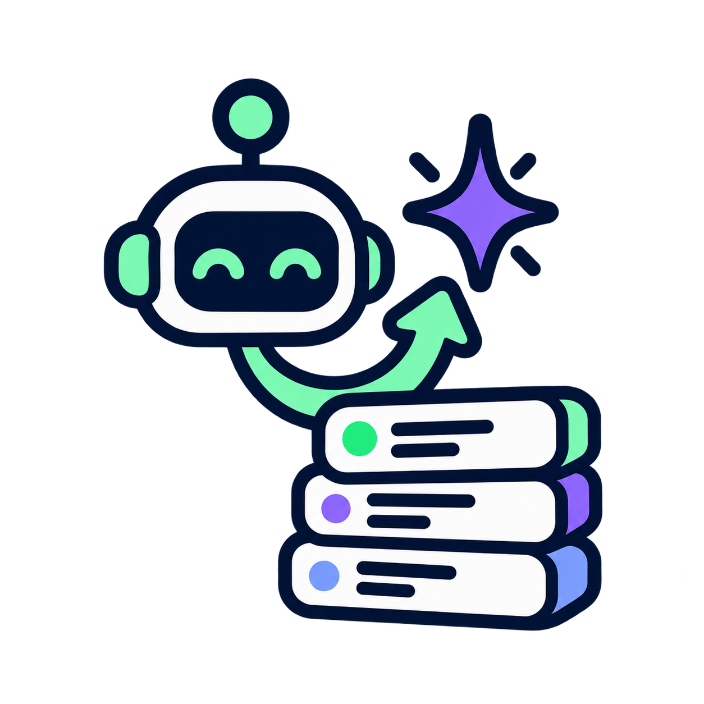
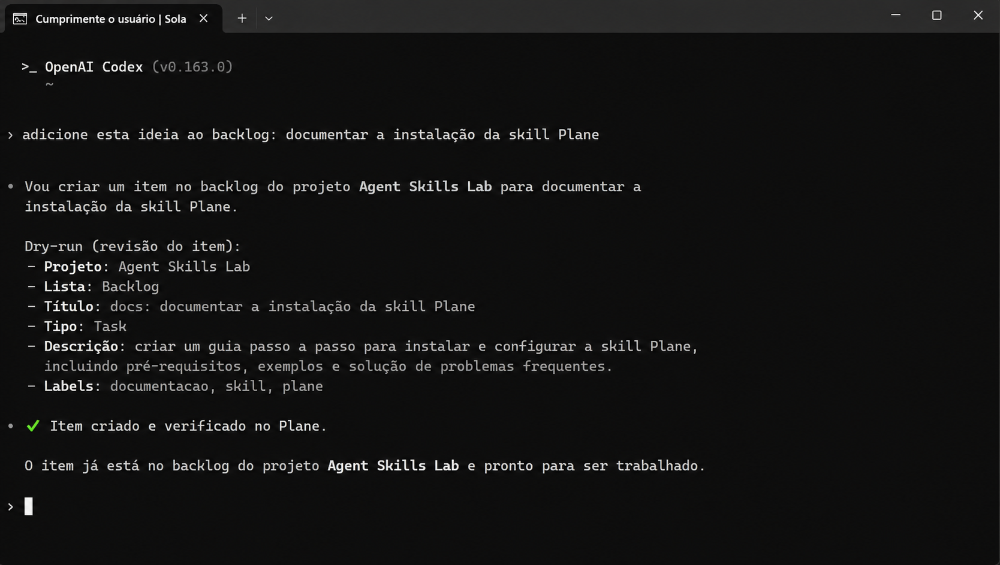
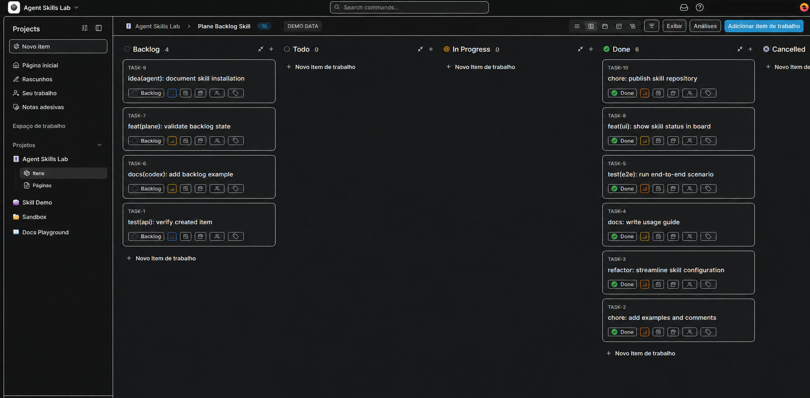
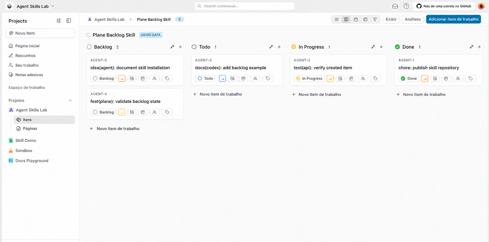

<div align="center">



# Plane Backlog Skill

**A small, auditable bridge between coding agents and a self-hosted Plane backlog.**

Capture ideas from Codex, Claude, Antigravity or another skill-capable agent and place them in the right Plane project without building a daemon, queue or second task system.

[](LICENSE)
[](#-requirements)
[](#-requirements)
[](https://github.com/solanosolutions/plane-backlog/stargazers)



[**Install**](#-installation) · [Features](#-features) · [How it works](#-how-it-works) · [Security](#-security) · [FAQ](#-faq) · [Roadmap](#-roadmap)

</div>

---

## Why this skill?

An agent can understand an idea, but that does not mean it should silently decide where the idea belongs. This skill makes the handoff explicit: resolve the repository, map it to a configured Plane project, confirm the unique Backlog state, preview the payload, and only then create and verify the work item.

**Small by design.** No background service. No n8n. No TwentyCRM. No semantic duplicate engine. Just a Markdown skill contract and one Python standard-library script that talks to the Plane API you already operate.

## ✨ Features

| | |
|---|---|
| 🧭 **Project-aware** | Resolves the active repository from its actual filesystem path and prefers the most specific mapping. |
| 🧪 **Dry-run first** | Review the exact payload before any write; `--confirm` is required for creation. |
| 🗂️ **Backlog-only** | Requires exactly one Plane state with `group=backlog` before creating an item. |
| ✅ **Write verification** | Fetches the new work item again and verifies that it remains in Backlog. |
| 🧼 **Standard library** | Python 3.10+ with no third-party runtime dependency. |
| 🔐 **Secret-aware** | Uses environment injection, ignores `.env`, escapes descriptions and never executes issue text. |
| 🌎 **Agent-friendly** | Package the same `SKILL.md` in Codex, Claude-based or Antigravity-style skill directories. |

## 👀 See it in action

The screenshots below are synthetic product demos with fictional data. They show the intended relationship between the skill and the system it feeds: an agent receives a natural-language idea, creates a verified work item, and the idea appears in a self-hosted Plane backlog.

<p align="center">

</p>

<p align="center"><sub>Fictional Plane board · all projects, cards and identifiers are demo data.</sub></p>

<p align="center">

</p>

<p align="center"><sub>Light-mode variation using the same fictional Agent Skills Lab project.</sub></p>

<p align="center">

</p>

<p align="center"><sub>Conceptual Codex → Plane flow · not a capture of a real account or workspace.</sub></p>

## 🧰 Requirements

- Python 3.10 or newer.
- A self-hosted Plane instance reachable from the agent runtime.
- A Plane personal API token with project write access.
- A sanitized project mapping in `config/projects.json`.

## 📥 Installation

### 1. Copy the skill

Place this repository in a stable skills directory and register `SKILL.md` in your agent runtime. Skill registration is runtime-specific; copying the folder alone does not activate it.

### 2. Configure a private connection

```powershell
$env:PLANE_BASE_URL = 'https://plane.example.com'
$env:PLANE_WORKSPACE = 'your-workspace'
$env:PLANE_API_KEY = Read-Host 'Plane API token'
```

Copy `config/projects.example.json` to `config/projects.json`, then replace the example project mapping with verified Plane project IDs and local repository roots. Keep both files out of public commits when they contain real workspace data.

### 3. Dry-run a capture

```powershell
python .\scripts\create_issue.py `
  --project-path 'C:\path\to\your\repository' `
  --title 'idea: add a release checklist' `
  --description 'Document the release workflow for contributors.'
```

Add `--confirm` only after reviewing the dry-run output.

## 🧭 How it works

```text
Agent request → local path mapping → Plane project
                                      ↓
                           unique Backlog state
                                      ↓
                         dry-run or confirmed POST
                                      ↓
                           GET and state verification
```

The script uses Plane's `/api/v1/` endpoints, sends the API key in the `X-API-Key` header, HTML-escapes the description and returns a compact JSON result. See [ARCHITECTURE.md](docs/ARCHITECTURE.md) for the trust boundaries and deliberate non-goals.

## 🔒 Security

- Never commit `.env`, API tokens or real workspace mappings.
- Use HTTPS for a remote Plane instance and least-privilege project access.
- Keep Plane private behind its intended access controls; do not expose the API just for this skill.
- Treat titles and descriptions as untrusted text; they are escaped before the request and never executed.
- Run the dry-run before every new project mapping or endpoint migration.

Read the full [security checklist](docs/SECURITY.md).

## ❓ FAQ

<details>
<summary><b>Does it automatically create issues?</b></summary>

No. The default invocation is a dry run. A real work item is created only when the caller explicitly adds `--confirm`.
</details>

<details>
<summary><b>Does it require n8n or TwentyCRM?</b></summary>

No. The current implementation uses Python's standard library and Plane's HTTP API.
</details>

<details>
<summary><b>Can it work with Codex, Claude and Antigravity?</b></summary>

The package is agent-runtime agnostic: it provides a Markdown skill contract and a local script. Each runtime must register the skill according to its own supported skills mechanism.
</details>

<details>
<summary><b>Does it support a self-hosted VPS?</b></summary>

Yes, provided the agent runtime can reach the Plane HTTPS endpoint. Back up Plane, preserve workspace/project IDs, verify the mapping and run a controlled dry-run plus create/GET check after migration.
</details>

## 🗺️ Roadmap

- [x] Path-based project resolution
- [x] Dry-run mode
- [x] Backlog state validation
- [x] Post-create verification
- [x] Sanitized public examples
- [ ] Optional configuration validation command
- [ ] Optional duplicate review helper
- [ ] Additional agent-runtime registration examples

## 🛠️ Build and test

There is no build step and no dependency installation. Validate syntax with:

```powershell
python -m py_compile .\scripts\create_issue.py
```

Use a dry run against a non-production test mapping before confirming a write.

## 🤝 Contributing

Issues and pull requests are welcome. Please keep credentials, private Plane URLs, real project IDs and local filesystem paths out of commits, logs and screenshots. See [CONTRIBUTING.md](CONTRIBUTING.md) for the publication checklist.

## ⭐ Like it?

If this skill keeps your agent's backlog tidy, **[give the repository a star](https://github.com/solanosolutions/plane-backlog/stargazers)** and share improvements through an issue or pull request.

---

<div align="center">
<sub>Made with 🧠 and 🛠️ by <a href="https://github.com/solanosolutions">Solano AI</a> · MIT License</sub>
<br><br>
<sub>Plane Backlog Skill is an independent open-source project and is not affiliated with, endorsed by, or sponsored by Plane.</sub>
</div>
